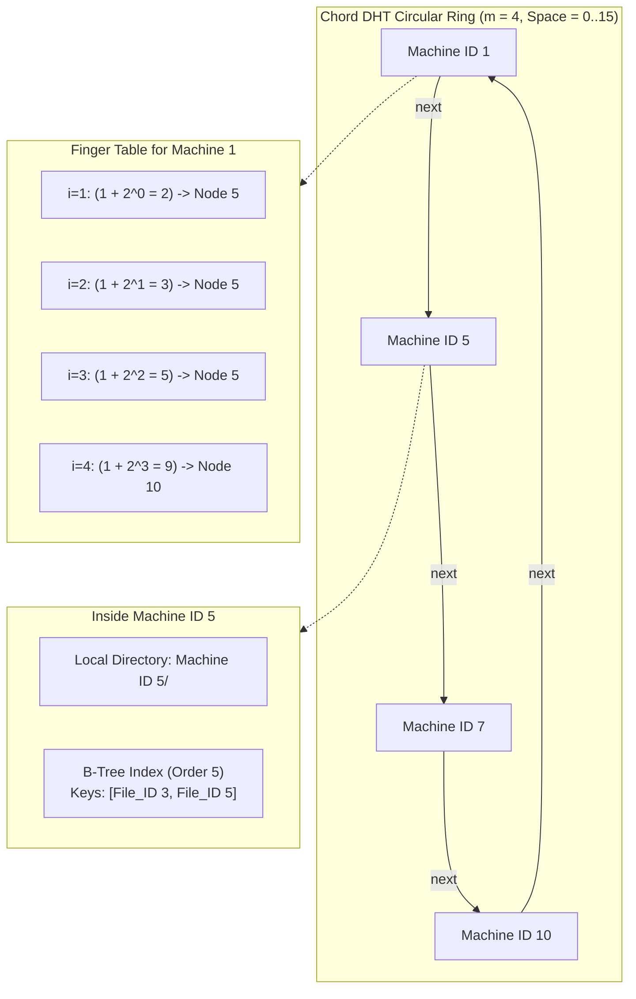
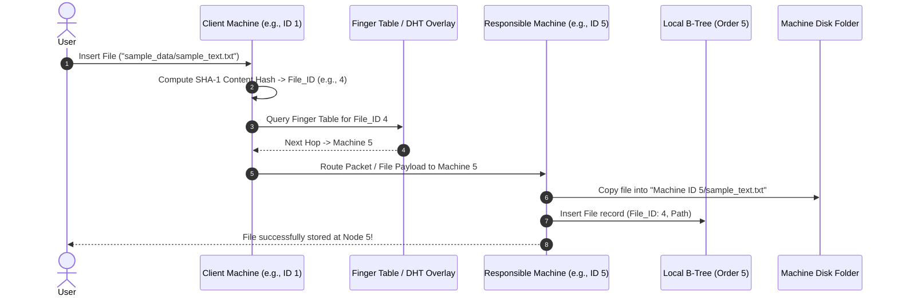

# Interplanetary File System (IPFS) Prototype & ISP Simulation

A distributed peer-to-peer storage network prototype and ISP routing simulation built in **C++**. This project implements a custom **Distributed Hash Table (DHT)**, **Circular Linked List routing (Chord ring topology)**, **B-Tree peer storage**, and **160-bit SHA-1 content addressing**.

> [!NOTE]
> **Academic Project Information**  
> - **Course Name**: Data Structures 
> - **Assigned Date**: November 22, 2023  
> - **Submission Date**: December 15, 2023

---

## Table of Contents
1. [Academic Project Overview](#academic-project-information)
2. [What is IPFS and What Does This Project Simulate?](#what-is-ipfs-and-what-does-this-project-simulate)
2. [How the Simulation Works in Detail](#how-the-simulation-works-in-detail)
   - [1. Content-Addressing Layer (SHA-1 & BigInt)](#1-content-addressing-layer-sha-1--bigint)
   - [2. Distributed Hash Table (DHT) & Circular Ring Topology](#2-distributed-hash-table-dht--circular-ring-topology)
   - [3. Finger Tables & Logarithmic ISP Routing Simulation](#3-finger-tables--logarithmic-isp-routing-simulation)
   - [4. Node-Level Decentralized Storage (B-Trees)](#4-node-level-decentralized-storage-b-trees)
   - [5. Network Churn & Self-Healing Data Migration](#5-network-churn--self-healing-data-migration)
3. [Architecture & Workflow Diagrams](#architecture--workflow-diagrams)
4. [Interactive Simulation Menu & Operations](#interactive-simulation-menu--operations)
5. [Directory Structure](#directory-structure)
6. [Building and Running](#building-and-running)

---

## What is IPFS and What Does This Project Simulate?

The **InterPlanetary File System (IPFS)** is a decentralized, peer-to-peer file sharing protocol designed to replace location-based addressing (such as HTTP URLs like `https://server.com/photo.jpg`) with **Content-Based Addressing**. In location-based architectures, files are tied to specific host servers; if the server is offline or the path changes, the link is broken. In contrast, IPFS identifies data by **what it contains**, not **where it is stored**.

This project provides an end-to-end, functional simulation of IPFS fundamentals combined with an ISP packet-routing layer:

| IPFS & Distributed Systems Concept | Implementation in this Project |
| :--- | :--- |
| **Content Addressing (CID)** | Files (text and raw image buffers) are cryptographically hashed using **SHA-1** (`HashCheck.h`). The hash determines the unique key (File ID) independent of filename. |
| **Distributed Hash Table (DHT)** | Implements a **Chord-style DHT overlay** over a circular identifier space $[0, 2^m - 1]$ managed by a `CircularLinkedList`. |
| **Node Placement & Key Assignment** | Each machine node occupies a position in the ring. A file key $k$ is stored on the first node whose ID $\ge k$ in clockwise ring order ($successor(k)$). |
| **Logarithmic Routing / ISP Hops** | Each peer maintains an $m$-entry **Finger Table** ($ID + 2^{i-1} \pmod{2^m}$). File requests skip exponentially across the network in $O(\log N)$ hops, simulating ISP packet routing. |
| **Decentralized Local Storage** | Each machine acts as an independent storage node with its own isolated directory on disk (`Machine ID <id>/`) and an internal in-memory **Order-5 B-Tree** for indexing local file metadata. |
| **Dynamic Network Churn (Fault Tolerance)** | Peers can dynamically join (`TurnMachineOn`) or leave (`TurnMachineOff`). The network self-heals by recalculating finger tables and migrating data on disk to maintain data availability. |
| **Multimodal Content Support** | Uses **OpenCV** to hash and render image files directly alongside standard text files. |

---

## How the Simulation Works in Detail

### 1. Content-Addressing Layer (SHA-1 & BigInt)
In this simulation, files are never addressed by arbitrary server paths. Instead:
1. **Hashing Mechanism**:
   - **Text Files**: Read stream-by-stream into memory and hashed using the custom SHA-1 algorithm implemented in [`HashCheck.h`](file:///HashCheck.h).
   - **Image Files**: Decoded into raw pixel matrices using OpenCV (`cv::Mat`). The underlying byte buffer is hashed (`sha1(const Mat& input)`).
2. **Address Space Mapping**:
   - SHA-1 produces a 160-bit hexadecimal digest.
   - For an identifier space configured with $m$ bits ($N = 2^m$ total possible machine addresses), the hash digest is mapped to a key in $[0, 2^m - 1]$.
   - The [`BigInt`](file:///BigInt.h) class enables arbitrary-precision arithmetic to support operations on massive 160-bit integer spaces without 64-bit overflow limitations.

### 2. Distributed Hash Table (DHT) & Circular Ring Topology
The overlay network is modeled as a logical circular ring of size $2^m$:
- Active machines are maintained in a sorted circular linked list (`CircularLinkedList`).
- Each machine node (`Machine`) is assigned a distinct numerical identifier in $[0, 2^m - 1]$ (e.g., in a 4-bit network, IDs range from 0 to 15).
- **Key Storage Rule**: A file with `File_ID` $k$ is owned by the node whose ID is the closest successor to $k$ in circular order:
  $$\text{Responsible Node} = \min \{ n \in \text{Active Nodes} \mid n \ge k \pmod{2^m} \}$$

### 3. Finger Tables & Logarithmic ISP Routing Simulation
A naive circular ring requires traversing nodes one-by-one ($O(N)$ lookup). To model efficient internet and peer-to-peer routing, this project implements Chord **Finger Tables**:
- For an $m$-bit space, each active machine stores an $m$-entry routing table (`DoublyLinkedList<Machine*>`).
- The $i$-th entry of machine $n$ ($1 \le i \le m$) points to the successor of:
  $$\text{Finger}[i] = (n + 2^{i-1}) \pmod{2^m}$$
- **Packet Routing (`Find_Responsible_Machine`)**:
  - When a user at `Machine A` requests a file with `File_ID`, the request queries `Machine A`'s finger table for the node closest to, but not exceeding, `File_ID`.
  - The request "hops" to that node, which forwards it again using its own local finger table.
  - This guarantees $O(\log N)$ hop resolution across the simulated ISP network.

### 4. Node-Level Decentralized Storage (B-Trees)
Each machine simulates a real physical storage server:
- **Physical Disk Isolation**: When a machine with ID $X$ is initialized, a dedicated folder `Machine ID X/` is provisioned on disk using `_mkdir()`.
- **In-Memory B-Tree Index**: Each machine node contains an **Order-5 B-Tree** (`btnode`):
  - Every node can store up to 4 keys and 5 child pointers.
  - File metadata records `File(File_ID, FilePath)` are indexed by `File_ID`.
  - Implements full multi-way search tree algorithms: balanced insertions with node splits (`split`), deletions with key borrowing (`leftshift`/`rightshift`), and child merges (`merge`).
- Storing a file copies the physical contents into `Machine ID X/<filename>` and registers the key in that machine's B-Tree.

### 5. Network Churn & Self-Healing Data Migration
In distributed networks, machines can go offline (churn) or new nodes can join. The simulation handles both gracefully:
- **Node Join (`TurnMachineOn`)**:
  1. A new machine $ID_{new}$ is added into the circular list and a storage directory `Machine ID <new>/` is created.
  2. All global finger tables are cleared and recomputed (`ClearRoutingTable` $\rightarrow$ `SetRoutingTable`).
  3. **Data Redistribution**: The newly joined node assumes responsibility for a segment of keys previously held by its clockwise successor. The simulation scans the successor's B-Tree, physically moves the files on disk to `Machine ID <new>/`, removes them from the successor's B-Tree, and inserts them into the new node's B-Tree.
- **Node Departure (`TurnMachineOff`)**:
  1. Before node $ID_{off}$ is powered down, all files stored in its local B-Tree are migrated to its immediate successor node on the ring.
  2. The physical files are moved to the successor's folder and indexed in the successor's B-Tree.
  3. Node $ID_{off}$ is removed from the active ring list and finger tables are refreshed.

---

## Architecture & Workflow Diagrams

### DHT Ring Topology & Finger Tables



### File Insertion & Retrieval Workflow



---

## Interactive Simulation Menu & Operations

When launching the program, the simulation starts with an interactive setup:
1. **Network Configuration**:
   - Specify the address space bit-width $m$ (e.g., entering `4` generates an address space of $2^4 = 16$).
   - Specify the number of active machines and choose between manual ID entry or randomized automatic assignment.
2. **Current Node Session**:
   - Select the machine from which you are interacting with the network.
3. **Interactive Menu Actions**:
   - **Insert File**: Provide a path (e.g., `sample_data\sample_text.txt` or `sample_data\sample_image.jpg`). The file is hashed, routed through the DHT, physically copied into the responsible machine's folder, and added to that machine's B-Tree.
   - **Delete File**: Locate and remove a file record from the responsible node's B-Tree and delete its physical copy on disk.
   - **View File / Display File**: Route to the responsible node and inspect content. Text is displayed in the console; images are opened in an OpenCV graphical window.
   - **Print Routing Table**: Inspect any machine's logarithmic finger table entries.
   - **Print B-Tree**: Visualize the balanced tree hierarchy and keys stored on a selected machine node.
   - **Turn Machine Off / On**: Simulate peer departure or joining with live data migration.

---

## Directory Structure

```text
├── main.cpp                  # Primary entry point & simulation engine
├── HashCheck.h               # SHA-1 hashing implementation (text & OpenCV Mat)
├── sha1.h                    # Core SHA-1 string hashing header
├── BigInt.h / BigInt.cpp     # Arbitrary-precision integer engine for 160-bit space
├── sample_data/              # Sample test inputs for simulation uploads
│   ├── sample_text.txt       # Sample text file (and Check.txt)
│   └── sample_image.jpg      # Sample image file (and 3.jpg)
├── archive/                  # Legacy iterations and scratch files
│   ├── Project.cpp           # Previous development draft
│   ├── temp.cpp              # BigInt prototyping scratchpad
│   └── README.md             # Archive documentation
├── Project.sln               # Visual Studio Solution
├── Project.vcxproj           # Visual Studio C++ Project configuration
├── Project.vcxproj.filters   # Solution Explorer filters
├── .gitignore                # Visual Studio and simulation cache ignore rules
└── README.md                 # Detailed architecture and simulation guide
```

---

## Building and Running

### Prerequisites
- **Visual Studio 2022** (v143 toolset, x64)
- **C++17** or **C++20**
- **OpenCV 4.x** (configured for x64 in Visual Studio):
  - Include Directory: `$(IncludePath);<path-to-opencv>\build\include`
  - Library Directory: `$(LibraryPath);<path-to-opencv>\build\x64\vc16\lib`
  - Additional Dependencies: `opencv_world481d.lib` (Debug) or `opencv_world481.lib` (Release)

### Running via Visual Studio
1. Open [Project.sln](file:///Project.sln) in Visual Studio 2022.
2. Select **Debug** or **Release** configuration on the **x64** platform.
3. Build the solution (`Ctrl + Shift + B`).
4. Run the simulation (`F5` or `Ctrl + F5`).
5. Follow the interactive console prompts:
   - Enter bit size (e.g. `4` for a 16-node ring or `5` for 32 nodes).
   - Enter number of machines to activate.
   - Test file operations using files from `sample_data\sample_text.txt` or `sample_data\sample_image.jpg`.
